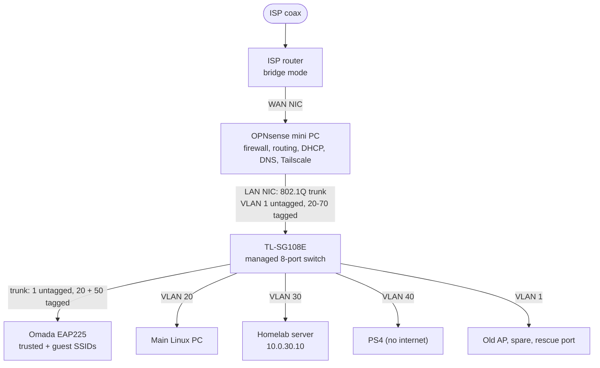
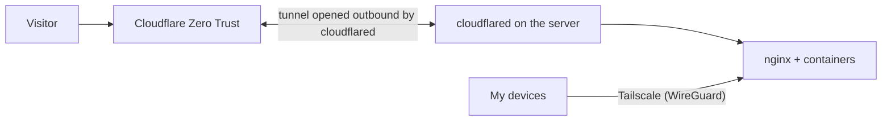

# Network

Segmented with 802.1Q VLANs since November 2026: OPNsense routes and firewalls seven segments over a single trunk to a managed switch. A dual-band access point maps one SSID to the trusted VLAN and one to an isolated guest VLAN.

## Topology

## Switch ports (TL-SG108E)

| Port | Device | Untagged / PVID | Tagged |
|---|---|---|---|
| 1 | OPNsense LAN | 1 | 20, 30, 40, 50, 60, 70 |
| 2 | Omada EAP225 | 1 | 20, 50 |
| 3 | Main Linux PC | 20 | |
| 4 | Homelab server | 30 | |
| 5 | PS4 | 40 | |
| 6 | Old AP (TL-WA801N), future IoT AP | 1 (planned: 60) | |
| 7 | Spare (planned: lab bench on VLAN 70) | 1 | |
| 8 | Rescue port for switch and firewall admin | 1 | |

## Addressing

DHCP comes from Dnsmasq on OPNsense, and DNS from Unbound. Each gateway is `.1` in its subnet.

| VLAN | Name | Subnet | Purpose |
|---|---|---|---|
| 1 (untagged) | MGMT | `10.0.0.0/24` | Switch, AP, firewall UI; legacy devices until they move |
| 20 | TRUSTED | `10.0.20.0/24` | My PC and laptop (the admin hosts) |
| 30 | SERVERS | `10.0.30.0/24` | Homelab server |
| 40 | SANDBOX | `10.0.40.0/24` | PS4, fully offline |
| 50 | GUEST | `10.0.50.0/24` | Guest Wi-Fi, internet only, 2 h leases |
| 60 | IOT | `10.0.60.0/24` | Smart lights, streaming stick (planned) |
| 70 | LAB | `10.0.70.0/24` | Air-gapped test bench (planned) |
| | Docker bridges | `172.17-172.31.0.0/16`, `192.168.208.0/20` | One per compose project, internal to the server |
| | Tailscale | `100.64.0.0/10` | Private remote access |

## Wi-Fi

| SSID | VLAN | Security | Notes |
|---|---|---|---|
| Trusted | 20 | WPA2-PSK (AES) | Same name on 2.4 and 5 GHz, band steering prefers 5 GHz |
| Guest | 50 | WPA2-PSK (AES) | Client isolation, 50/10 Mbps per client |

The AP runs in standalone mode (no controller). Its management interface stays untagged on VLAN 1, and the factory open SSIDs were deleted.

## Firewall policy

Rules are per interface and first match wins. Aliases: `PRIVATE_NETS` (RFC1918), `ADMIN_HOSTS`, `ADMIN_PORTS` (22, 80, 443), `TAILNET`.

| Interface | Policy |
|---|---|
| TRUSTED | Admin hosts reach everything; other devices are blocked from MGMT and firewall admin ports, otherwise allowed |
| SERVERS | DNS/NTP to the gateway, no new connections to private networks, internet allowed |
| SANDBOX | Everything blocked and logged (DHCP still works) |
| GUEST | DNS to the gateway, firewall and private networks blocked, internet allowed |
| IOT | DNS/NTP to the gateway, firewall and private networks blocked, internet allowed |
| LAB | DNS to the gateway only |
| TAILSCALE | Tailnet devices reach everything |
| WAN | Default deny, no port forwards |

On SERVERS, GUEST, and IOT, destination NAT redirects any DNS query not aimed at the firewall to Unbound. Hardcoded resolvers can't bypass filtering.

## Why this design

- **Bridge mode on the ISP router.** Avoids double NAT and makes OPNsense the single place where firewall policy lives.
- **Router-on-a-stick.** The J3455 has only two NICs, so all VLANs share one tagged trunk. Inter-VLAN traffic is limited to what the J3455 can route on one gigabit port, which is plenty for this house.
- **Trusted initiates, nothing initiates into trusted.** A compromised server, console, guest phone, or IoT gadget can't reach my PC, and stateful rules still let my PC reach all of them.
- **MGMT on VLAN 1.** I kept the existing `10.0.0.0/24` LAN as the management network instead of renumbering, which kept the migration low-risk. On this switch model, VLAN 1 is also the safe home for the switch's own admin page.
- **Additive migration.** Every VLAN, DHCP range, and rule was built before any device moved. Devices then moved one at a time, with a VLAN 1 rescue port as a fallback.

## Remote access

The tunnel connection is initiated from inside my network, so the router has no port forwards for these services. Admin surfaces (Portainer and SSH) sit behind Cloudflare Access identity policies. My own devices can skip the public path and use Tailscale, a WireGuard-based mesh VPN.

Tailscale runs on OPNsense itself (the `os-tailscale` plugin) as a subnet router. It advertises every VLAN except GUEST, so remote devices arrive on their own firewall interface with admin-level rules. Accept-DNS is off on the router so the tailnet can't override its resolver, and node key expiry is disabled so the router doesn't drop off silently. I chose this over self-hosted WireGuard because it needs no open WAN port and no dynamic DNS.

## Monitoring

OPNsense's built-in monitoring watches traffic at the edge; Uptime Kuma watches each service.

<!-- TODO: name the specific OPNsense monitoring features you use (e.g. Insight/NetFlow, firewall logs, alerts). -->

## Next

- Move the old access point (IoT, VLAN 60) and a lab bench switch (VLAN 70) onto ports 6 and 7 once power and cabling allow.
- Lock down VLAN 1 (MGMT) so it holds only the switch, AP, and firewall.
- FQ-CoDel shaping for bufferbloat; per-VLAN traffic dashboards.

See [docs/security.md](../docs/security.md) for the full hardening roadmap.
